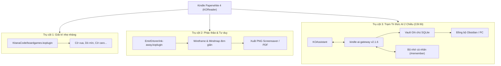

# Kế hoạch Tổng thể Nâng cấp Kindle Paperwhite 4
## Game, Phác thảo Sơ đồ & Trạm Tri thức AI 2 Chiều

> **Thiết bị mục tiêu:** Kindle Paperwhite 4 (PQ94WIF - 10th Gen, 300 DPI, FW 5.18.1.1.1, KOReader v2026.07.2)  
> **Trạng thái:** Bản thảo kế hoạch — Chờ phê duyệt trước khi triển khai  
> **Ngày lập:** 2026-11-01  

---

## 1. Bối cảnh & Mục tiêu Chiến lược

Thiết bị Kindle Paperwhite 4 hiện đã được Jailbreak, cài đặt KOReader và KOAssistant kết nối với dự án [`kindle-ai-gateway`](file:///D:/QQ/kindle/kindle-ai-gateway). Mục tiêu của kế hoạch này là tối đa hóa giá trị sử dụng của thiết bị thông qua 3 trụ cột song song:

---

## 2. Chi tiết 3 Trụ cột Kỹ thuật

### Trụ cột 1: Tích hợp Gói Game E-ink (`boardgames.koplugin`)
- **Nguồn:** [`KitanaCode/boardgames.koplugin`](https://github.com/KitanaCode/boardgames.koplugin)
- **Các game tích hợp:** Cờ vua (Chess), Cờ đam (Checkers), Connect 4, Tic Tac Toe, Dò mìn (Minesweeper), Thủy chiến (Battleship).
- **Đặc điểm kỹ thuật:**
  - Viết bằng Lua thuần trên framework Widget của KOReader.
  - Tối ưu hóa độ tương phản đen/trắng cao cho màn hình E-ink Carta.
  - Sử dụng cơ chế partial refresh khi di chuyển quân cờ, không gây chớp toàn màn hình.
- **Kế hoạch triển khai:**
  1. Tải bản phát hành (release package) từ repository.
  2. Triển khai vào thư mục: `E:\koreader\plugins\boardgames.koplugin`.
  3. Kiểm tra hiển thị tỉ lệ bàn cờ trên độ phân giải $1072 \times 1448$ (DPI 300) của PW4.
  4. Đánh giá độ nhạy cảm ứng khi chạm chọn ô bàn cờ.

---

### Trụ cột 2: Ứng dụng Phác thảo & Sơ đồ tư duy (`ink-away.koplugin`)
- **Nguồn:** [`EmirErtorer/ink-away.koplugin`](https://github.com/EmirErtorer/ink-away.koplugin)
- **Đặc điểm kỹ thuật:**
  - Hỗ trợ công cụ hình học (Shape, Arrow, Line) rất phù hợp cho **Wireframe** và **Sơ đồ tư duy dạng nhánh (Mindmap)**.
  - Hỗ trợ các lớp (Layers), thước kẻ, tẩy xóa, hoàn tác/làm lại (Undo/Redo).
  - Khả năng xuất file ảnh PNG trong suốt (thích hợp làm hình nền chờ Sleep Screen) hoặc xuất PDF nhiều trang.
- **Quy trình sử dụng tối ưu trên màn hình cảm ứng điện dung PW4:**
  - Không vẽ chữ viết tay tự do dài (tránh mỏi tay và nét nguệch ngoạc).
  - Sử dụng công cụ hình chữ nhật/oval để tạo các khối nội dung (Nodes).
  - Sử dụng công cụ mũi tên (Arrows) để nối các nhánh tư duy.
  - Dùng công cụ Text box (nhập văn bản qua bàn phím ảo) để gán nhãn cho sơ đồ.
- **Kế hoạch triển khai:**
  1. Tải bản đóng gói từ repository.
  2. Triển khai vào thư mục: `E:\koreader\plugins\ink-away.koplugin`.
  3. Thử nghiệm trên thiết bị thật: kiểm tra độ trễ nét vẽ khi dùng ngón tay và khả năng lưu/xuất file vào thư mục `E:\koreader\clipboard` hoặc `E:\documents`.

---

### Trụ cột 3 (Trọng tâm cốt lõi): Trạm Tri thức Đọc sách AI 2 Chiều

Đây là trụ cột quan trọng nhất, kết nối trực tiếp Kindle PW4 với hệ sinh thái [`kindle-ai-gateway`](file:///D:/QQ/kindle/kindle-ai-gateway).

#### 3.1. Hoàn thiện hạ tầng Gateway Production
- Triển khai phiên bản **2.1.6** lên máy chủ Dokploy (`kindle.alphatech.ai.vn`).
- Xác nhận endpoint `/health` trả về `version: "2.1.6"`.
- Chạy kiểm thử smoke test chỉ-đọc `python scripts/smoke_production.py` để đảm bảo API Auth, rate limit và SQLite Vault sẵn sàng.

#### 3.2. Cấu hình Quick Context Actions trong KOReader (Giảm tải gõ phím)
Gõ bàn phím ảo trên E-ink rất chậm. Do đó, trải nghiệm AI sẽ được tối ưu qua các tác vụ 1 chạm:
- Highlight đoạn văn bản trong sách $\rightarrow$ Mở menu KOAssistant với các mẫu câu hỏi định sẵn:
  - *"Tóm tắt 3 luận điểm then chốt của đoạn này."*
  - *"Giải thích thuật ngữ chuyên ngành này bằng ví dụ đời sống."*
  - *"Chỉ ra phản biện hoặc điểm yếu trong lập luận của tác giả."*
  - *"Tạo một câu hỏi trắc nghiệm để kiểm tra mức độ hiểu bài."*

#### 3.3. Dòng chảy Ghi chú & Bộ nhớ 2 chiều (Zero-cable Sync)
- **Ghi chú nhanh từ Kindle:**
  - Gõ `#note [Tiêu đề] <Nội dung>`: Tự động ghi vào SQLite Vault trên server kèm metadata (thời gian, sách, tags).
  - Gõ `#todo <Công việc>`: Đưa vào danh sách nhiệm vụ cần hành động sau khi đọc sách.
  - Gõ `#remember [Chủ đề] <Bối cảnh/Sở thích>`: Cập nhật persona người dùng vào bộ nhớ cá nhân an toàn (Safe Memory).
- **Đồng bộ về máy tính (Obsidian / Markdown):**
  - Gateway định kỳ hoặc theo yêu cầu export các note trong Vault thành file `.md` chuẩn.
  - Máy tính kết nối tải file backup hoặc đồng bộ qua script/API, giúp toàn bộ ghi chú đọc sách ban đêm tự động xuất hiện trong hệ thống ghi chú trên máy tính.

---

## 3. Lộ trình Triển khai Chi tiết (4 Giai đoạn)

| Giai đoạn | Nội dung công việc | Điều kiện nghiệm thu (Acceptance Criteria) |
|---|---|---|
| **Phase 1: Thử nghiệm Plugins (An toàn, không đổi hệ thống)** | • Tải và copy `boardgames.koplugin` vào `E:\koreader\plugins` • Tải và copy `ink-away.koplugin` vào `E:\koreader\plugins` • Khởi động lại KOReader trên Kindle để nhận diện plugin | • Menu KOReader xuất hiện mục Board Games và Ink-away. • Chơi thử được 1 ván Cờ vua/Dò mìn. • Vẽ và lưu thử được 1 sơ đồ mindmap đơn giản thành file ảnh. |
| **Phase 2: Deploy & Xác minh Production Gateway** | • Đẩy commit `2bc07ed` (v2.1.6) lên server qua Dokploy. • Chạy script smoke-test production chỉ-đọc. | • Endpoint `/health` trả `version: 2.1.6`. • Xác thực API Bearer token hoạt động đúng. • Vault database online và ghi nhận trạng thái healthy. |
| **Phase 3: Kiểm thử Tương tác AI trên Kindle thật** | • Kết nối Kindle với Wi-Fi. • Mở KOAssistant trên sách thật. • Thử nghiệm chuỗi lệnh: `#help`, `#remember`, `#memory`, `#note`. | • AI phản hồi nhanh, layout vừa màn hình E-ink. • `#remember` lưu thành công bối cảnh đọc sách. • `#memory` hiển thị danh sách ghi nhớ. • `#note` lưu thành công vào server. |
| **Phase 4: Tự động hóa Đồng bộ Tri thức (Vault ➔ PC)** | • Thiết lập script tải hoặc sync tự động các ghi chú Markdown từ Dashboard/Vault về thư mục PC. • Liên kết với thư mục Obsidian/Notion. | • Note ghi trên Kindle tự động xuất hiện dạng Markdown trên PC mà không cần cắm cáp USB. |

---

## 4. Bảng Đánh giá Rủi ro & Phương án Rollback

| Rủi ro tiềm ẩn | Mức độ | Biện pháp phòng ngừa & Xử lý |
|---|---|---|
| **Plugin gây crash KOReader khi khởi động** | Thấp | KOReader lưu log tại `E:\koreader\crash.log`. Nếu plugin bị lỗi cú pháp Lua, chỉ cần cắm cáp USB và xóa thư mục plugin đó khỏi `E:\koreader\plugins`. |
| **Bút vẽ/Nét vẽ trên PW4 bị delay** | Trung bình | `ink-away` được thiết kế có thể cấu hình chế độ vẽ. Nếu vẽ tay bằng ngón tay quá trễ, chuyển sang dùng chế độ Shape/Line để dựng sơ đồ tư duy thay vì vẽ nét tự do. |
| **Hao pin khi bật Wi-Fi để dùng AI** | Trung bình | KOReader có sẵn plugin `autostandby` và `autosuspend`. Khuyên dùng Wi-Fi chỉ khi thực sự cần tra cứu/ghi chú AI; khi đọc thuần túy nên tắt Wi-Fi. |
| **Lỗi mạng khi gọi Gateway từ Kindle** | Thấp | Gateway v2.1.6 đã có xử lý ngắt kết nối an toàn, timeout riêng và không lưu log nhạy cảm. |

---

> [!IMPORTANT]
> **Quyết định tiếp theo:**  
> Kế hoạch này được chia làm 4 giai đoạn độc lập. Giai đoạn 1 (thử nghiệm 2 plugin trên ổ `E:\`) hoàn toàn an toàn và không ảnh hưởng đến firmware gốc hay server production. Hãy xem xét và xác nhận nếu bạn muốn bắt đầu tiến hành Giai đoạn 1.
